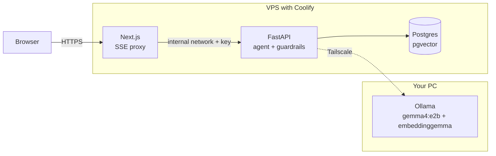

# Aurora Electro · AI support agent

A demo support agent for a fictional store: **RAG**, **tools** with human confirmation, and **guardrails**, running on a local model. 



The VPS only runs the app (≈ 1 GB of RAM is plenty); the models live on your PC and are reached over a private Tailscale network. Only the frontend has a public domain.

## What it demonstrates

| Piece | How it is built |
|---|---|
| **RAG** | Markdown-heading-aware chunking, embeddings with `embeddinggemma`, **hybrid** search (vector + English full-text, fused with RRF) in pgvector, a **relevance threshold** so the agent can say "I don't know", and sources cited in the UI. |
| **Tools** | `search_knowledge_base`, `get_order_status` (requires the order number **and** the email, so nobody can look up someone else's order) and `create_ticket`. Pydantic models → JSON Schema, strict validation, and errors fed back to the model so it can correct itself. |
| **Actions with side effects** | `create_ticket` is never executed by the LLM: it returns an action **signed with HMAC**, and the ticket is only created after the user clicks Confirm in `/api/confirm` (with expiry and anti-replay). |
| **Input guardrails** | Length, prompt injection (EN/ES, Unicode normalization and invisible-character stripping), masking of cards (Luhn-validated) and CURP, and a check of the history sent by the browser (it may have been tampered with). |
| **Output guardrails** | Prompt leak (canary + n-grams), **ungrounded figures** (every number in the answer must appear in the sources, in a tool result, or in what the user said), invented actions ("I already created your ticket"), PII. On failure: one retry with feedback, then a safe answer. |
| **English and Spanish** | The knowledge base and the system prompt are in English. The customer's language is detected **on the server** (function words, no libraries or LLM) and pinned in the prompt, so Spanish-speaking customers get answers in Spanish: the model searches in English and translates when answering. If a message is ambiguous (e.g. just `ORD-10001`) the language of the history is used, then the UI's. Guardrails, error messages and ticket confirmations work in both languages, and the UI has an EN/ES toggle. |
| **Operations** | Per-IP rate limit, a cap on concurrent model calls, SSE heartbeat, an "model offline" state in the UI, and a side-by-side model evaluation. |

The guardrails are **deterministic rules**, not a second LLM: with small models, asking the model to police itself is unreliable, and rules cost zero tokens and are auditable.

## Structure

```
backend/
  app/
    agent.py          tool-calling loop (events → SSE)
    tools.py          tools, validation and confirmation
    confirm.py        HMAC-signed actions
    guardrails/       input.py · output.py (EN + ES)
    lang.py           language detection and localized messages
    prompts.py        system prompt (with canary)
    rag/              chunking · ingest · retriever
    db.py             pgvector + FTS + demo data
    main.py           FastAPI (/api/chat, /api/confirm, /api/health)
  data/docs/          6 knowledge-base documents (English)
  eval/               37 cases (23 Spanish, 14 English) + model comparison
  tests/              101 tests (no Ollama or Postgres needed)
frontend/             Next.js 16: chat, agent steps, confirmation card
docker-compose.yml    deployment on the VPS (Coolify)
docker-compose.ollama.yml   Ollama + Tailscale in Docker, for the PC that hosts the models
```

## Running locally

**1. Models on your PC** (Ollama ≥ 0.20, required for Gemma 4):

```bash
ollama pull gemma4:e2b
ollama pull embeddinggemma
```

**2. Database and backend**

```bash
docker compose -f docker-compose.dev.yml up -d
cd backend
python -m venv .venv && source .venv/bin/activate
pip install -r requirements-dev.txt
cp .env.example .env
python -m app.rag.ingest                       # creates the tables and indexes the 6 documents
uvicorn app.main:app_factory --factory --reload
```

**3. Frontend**

```bash
cd frontend
npm install
BACKEND_URL=http://localhost:8000 npm run dev   # http://localhost:3000
```

**4. Tests and evaluation**

```bash
cd backend
pytest                                          # 101 tests, no Ollama needed
python -m eval.run_eval --models gemma4:e2b,gemma4:e4b,qwen3:4b
```

The evaluation writes `eval/results/<date>.md` with a comparison table (correct cases, tool choice, valid arguments, reply language, whether the search query is in English, latency, tokens) and per-case detail. Use `--only en_kb,en_order,…` or `--only es_kb,es_order,…` to run one language. Also use it to **calibrate `MIN_SCORE`**: if the agent says "I don't know" when it should know, lower it; if it answers with irrelevant context, raise it.

> Test data: orders `ORD-10001` to `ORD-10005` with the emails listed in the UI itself (all fictional).

## Deployment: VPS with Coolify + models on your PC

**A. Models on your PC, connected to the VPS with Tailscale**

*Option 1 (recommended): everything in Docker.* Nothing but Docker is installed on your PC: `docker-compose.ollama.yml` runs Ollama together with a Tailscale container, and Ollama is reachable only from your tailnet (no ports are published).

1. In the Tailscale admin console create an account/tailnet and generate an **auth key** (Settings → Keys).
2. On your PC:
   ```bash
   cp .env.ollama.example .env.ollama        # put the auth key in TS_AUTHKEY
   docker compose -f docker-compose.ollama.yml --env-file .env.ollama up -d
   ```
   The `pull-models` helper downloads `gemma4:e2b` and `embeddinggemma` the first time (check with `docker compose -f docker-compose.ollama.yml logs -f pull-models`). For an NVIDIA GPU, uncomment `gpus: all` in the file.
3. In the admin console you will see a device called `ollama-pc`; note its IP (starts with `100.`).
4. Install Tailscale on the **VPS** (`curl -fsSL https://tailscale.com/install.sh | sh`, then `tailscale up`) using the same account.
5. (Recommended) In the Tailscale ACLs, let the VPS reach only port 11434 of `ollama-pc`.
6. Test from the VPS: `curl http://100.x.y.z:11434/api/tags`.

If the Tailscale container cannot start on your Docker setup (usually because of `/dev/net/tun`), follow the comment in the file to use userspace networking, or use Option 2.

*Option 2: Tailscale installed on the PC itself.* Install Tailscale on your PC and the VPS and sign in to the same account; get the PC's IP with `tailscale ip -4`. Make Ollama listen **only on that IP** (do not use `0.0.0.0`, which exposes it to your local network):
   - Linux: `sudo systemctl edit ollama` → `Environment="OLLAMA_HOST=100.x.y.z:11434"` and `Environment="OLLAMA_KEEP_ALIVE=30m"`.
   - Windows: user environment variables `OLLAMA_HOST=100.x.y.z:11434` and `OLLAMA_KEEP_ALIVE=30m`; restart Ollama.
   - Pull the models (`ollama pull gemma4:e2b`, `ollama pull embeddinggemma`; Ollama ≥ 0.20 is required for Gemma 4) and test from the VPS as above.

**B. Coolify**

1. *New resource → Docker Compose* pointing at this repository (`docker-compose.yml`).
2. Under *Environment Variables* define what `.env.example` lists: `POSTGRES_PASSWORD`, `INTERNAL_API_KEY`, `CONFIRM_SECRET` (generate with `openssl rand -hex 32`) and `OLLAMA_BASE_URL=http://100.x.y.z:11434`.
3. Assign your domain to the **frontend** service (port 3000). The backend and the database are not exposed.
4. Deploy. On startup the backend creates the tables and ingests the documents; if your PC is off it still starts and retries on the next restart (you can also run `python -m app.rag.ingest` inside the container).

If the container cannot reach the host's Tailscale IP, add a `tailscale` container as a sidecar in the compose file and point `OLLAMA_BASE_URL` through it.

## Design decisions and limits

- **Own loop instead of LangGraph:** it is ~170 lines and can be explained end to end. A framework makes sense once there are branching flows, persistent memory or several agents.
- **The final answer is not streamed token by token:** the output guardrail needs the complete answer before showing it. The UI does stream the *steps* (tools and guardrails) over SSE. This is a deliberate trade-off between perceived latency and safety.
- **The figures guardrail is heuristic:** it catches invented prices, deadlines and quantities (the costliest failure of a support agent), but it does not verify claims that contain no numbers. That would need an entailment checker or an LLM judge.
- **One English knowledge base, two languages:** this is the simplest option and avoids maintaining two knowledge bases, but it relies on the model translating well when it answers and on `embeddinggemma` handling Spanish questions well if the model ever searches in Spanish. If the Spanish evaluation comes out weak, the alternative is to keep per-language documents and store the language as chunk metadata. Language detection only tells Spanish from English; any other language is treated as English.
- **In-memory state:** the rate limit and token anti-replay only work with a single backend instance. With several, move them to Redis/Postgres.
- **Order verification by email:** this is a demonstration of basic authorization, not a real authentication system. In production you would use the customer's session.
- **Availability:** if your PC is switched off, the demo shows "model offline". For an always-on demo, add a fallback model behind an API behind the same interface (`OllamaClient`).

## Possible next steps

Tracing with Langfuse (self-hostable on Coolify), a reranker over the RAG candidates, LLM-judge evaluation for answer faithfulness, and real authentication for order status.
